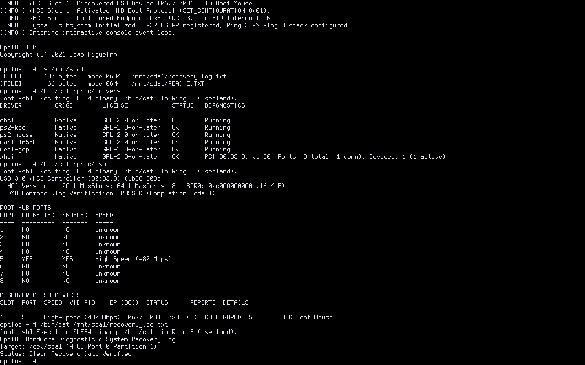
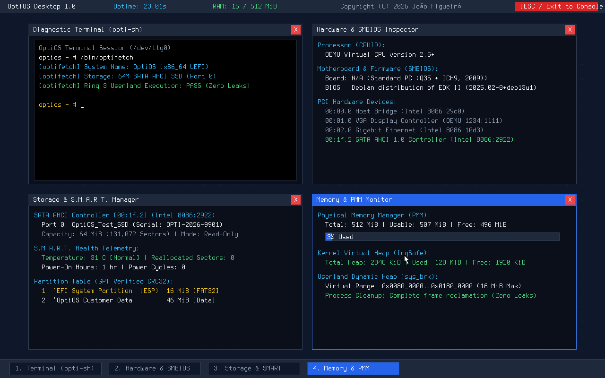

# OptiOS

An experimental x86-64 UEFI operating system written in Rust (`no_std`).
A learning project and an experiment in AI-assisted systems engineering.

[Leia em Português (README.pt-BR.md)](README.pt-BR.md)

> **Status: early alpha.** Boots in QEMU only; not tested on real hardware.
> There is no USB keyboard support yet. Do not run it on machines with data
> you care about. See [`docs/status.md`](docs/status.md) and [`docs/known-issues.md`](docs/known-issues.md).

## Why this exists
OptiOS started from a question: how far can AI coding agents take an operating
system from an empty repository, when a human sets the direction and reviews
the work? Doing the same by hand would take years. It is also a way to learn
the standards and fundamentals behind modern systems: UEFI, x86-64, POSIX
conventions, AHCI, xHCI and more. Expect bugs and inconsistencies. The goal is
learning, not production use.

## How it is built
- Humans decide requirements, architecture and licensing, and review the work.
- Most code is written by AI coding agents under documented rules
  ([`AGENTS.md`](AGENTS.md), [`docs/process/`](docs/process/)).
- Each change is expected to come with evidence (tests, serial logs). Audits,
  including their failures, are published in [`docs/reports/`](docs/reports/).
- "From scratch" has limits: the kernel and drivers are written new, but the
  project uses the Limine bootloader and a few Rust crates
  ([`THIRD_PARTY_NOTICES.md`](THIRD_PARTY_NOTICES.md)), follows public specifications, and the AI models
  were trained on existing code. See [`docs/ai-assisted-development.md`](docs/ai-assisted-development.md).

## Goals
1. A portable maintenance and diagnostic live system, read-only by construction.
2. Growth toward an installable general-purpose OS.
3. Follow common Unix/POSIX conventions ("POSIX-oriented", not certified).
4. A design goal: make it feasible to port drivers from BSD systems and from
   GPL-compatible Linux sources with little adaptation. No foreign driver has
   been ported yet.

## Current state
Summary of implemented and partial subsystems (see [`docs/status.md`](docs/status.md) and [`docs/known-issues.md`](docs/known-issues.md) for verification evidence and limitations):

- **Boot and CPU setup**: UEFI boot via Limine protocol; 64-bit GDT, TSS (IST 1), IDT exception and IRQ gates; CR4 SMEP and SMAP enabled with `stac`/`clac` user-copy helpers.
- **Memory management**: Physical frame bitmap allocator (PMM) reserving the lower 1 MiB; 4-level virtual memory paging (VMM) with Higher-Half Direct Map (HHDM) and a 2 MiB IRQ-safe kernel heap. Intermediate user page tables are pre-allocated for fixed address ranges; ELF segment W^X enforcement is not implemented yet.
- **Hardware enumeration and base I/O**: SMBIOS 2.8 parser, PCI bus scanner (`0..=255`), Dual 8259 PIC, PIT timer (100 Hz), 16550 UART serial console, PS/2 keyboard (IRQ 1), and PS/2 mouse (IRQ 12).
- **Driver Kit**: `MmioRegion` and 4 KiB-aligned `DmaBuffer` primitives, source-agnostic `InputEvent` queue, and driver registry exposed at `/proc/drivers`.
- **Storage and filesystems (read-only)**: SATA AHCI 1.0 driver (DMA reads, ATA IDENTIFY, S.M.A.R.T. read data; 512-byte sectors only), MBR and GPT partition table parsers, read-only USTAR initramfs at `/`, read-only FAT32 mount at `/mnt/sda1` (`MNT_NOEXEC`), and synthetic `/proc` entries (`version`, `meminfo`, `cpuinfo`, `drivers`, `usb`).
- **USB 3.0 xHCI**: Controller initialization, Command Ring DMA verification, Root Hub port reset, Slot addressing, EP0 control transfers, and USB HID Boot Mouse interrupt IN reports on Endpoint `0x81` (DCI 3). USB HID Keyboard support is not implemented yet.
- **Userland and console/GUI**: Single-process synchronous Ring 3 ELF64 execution via `syscall`/`sysretq` (`sys_read`, `sys_write`, `sys_open`, `sys_close`, `sys_stat`, `sys_lseek`, `sys_brk`, `sys_getpid`, `sys_exit`, `sys_uname`) with `/bin/sysinfo`, `/bin/cat`, `/bin/optifetch`, and `/bin/edit`. 160x50 ANSI text console on the double-buffered UEFI GOP framebuffer and an on-demand floating window desktop (`gui`).

| Console & FAT32 / xHCI Telemetry | Ring 3 Text Inspector (`/bin/edit`) | Graphical Desktop (`gui`) |
| :---: | :---: | :---: |
|  |  |  |

## Roadmap
From [`docs/roadmap.md`](docs/roadmap.md) (in authoritative R0–R8 order):

- **R0 Stabilize**: Phases 0–2 (Governance/licensing, verification audit, approved fixes, doc accuracy).
- **R1 Driver architecture**: ADR, Driver Kit skeleton, `InputEvent` abstraction, AHCI/PS2/mouse/framebuffer/serial refitted as conformance cases.
- **R2 USB**: xHCI (init, enumeration, HID boot keyboard/mouse, hubs), whitelisted control requests; EHCI/UHCI/OHCI only on demand.
- **R3 Platform**: ACPI tables (MADT/MCFG/FADT), IOAPIC/LAPIC, MSI/MSI-X, calibrated timers, SMP bring-up; decision on an AML interpreter.
- **R4 Storage/FS**: NVMe (native — Planned in R4), block cache, FAT32 hardening, 4Kn sector-size correctness, ext4/NTFS read-only.
- **R5 Process model**: Preemptive scheduler (multitasking is not implemented / planned in R5) with IRQ-safe locks, per-process fd table, pipes, TTY line discipline, `posix_spawn`, libc/runtime decision.
- **R6 Foreign-driver pilot**: `bsd_compat` shim + one NIC from a permissively licensed BSD source (e.g. the Intel 82574L, `8086:10d3`, already present in QEMU), then a network stack.
- **R7 Installed profile**: Write capability, journaling/CoW FS writes, installer, bootloader management, users/permissions, power management.
- **R8 Graphics/UI**: Userland compositor, PAT write-combining, fonts, `virtio-gpu`; Wi-Fi via port only if product scope requires.

## Build and run
### Prerequisites (Debian/Ubuntu)
Rust toolchain (with `rust-src`, `llvm-tools-preview`, and `x86_64-unknown-none` target; see [`rust-toolchain.toml`](rust-toolchain.toml)), `qemu-system-x86`, `ovmf` (`/usr/share/ovmf/OVMF.fd`), `xorriso`, `git`, and `python3`.

### 1. Run license check and host unit tests (85 tests across 8 host crates)
```bash
./scripts/license-check.sh
./scripts/test.sh
```

### 2. Build kernel, Ring 3 userland utilities, and UEFI bootable ISO (`build/optios.iso`)
```bash
./scripts/build.sh release
```

### 3. Run automated headless QEMU verification (boots with OVMF, AHCI disk, and xHCI mouse)
```bash
./scripts/run.sh --test
```

### 4. Launch interactive QEMU graphical session
```bash
./scripts/run.sh --gui
```

> **WARNING — Destructive Operation (`dd`)**: Writing an ISO image to a block device (`dd if=build/optios.iso of=/dev/sdX bs=4M status=progress && sync`) overwrites the target disk partition table and destroys all data on `/dev/sdX`. Double-check the target device node with `lsblk` before running `dd`, and do not run OptiOS on physical machines with data you care about.

## Repository layout
- `kernel/` — Bare-metal x86-64 `no_std` kernel (`arch/`, `boot/`, `drivers/`, `firmware/`, `fs/`, `gui/`, `logger/`, `mm/`, `posix/`, `shell/`, `syscall/`).
- `libs/` — Hardware-independent `#![no_std]` crates tested on the host (`ahci-proto`, `ansi-parser`, `elf-loader`, `fat32`, `opti-libc`, `opti-wm`, `partition-table`, `ustar`, `xhci-proto`).
- `userland/` — Standalone Ring 3 ELF64 utilities (`cat`, `edit`, `optifetch`, `sysinfo`).
- `scripts/` — Build (`build.sh`), host test (`test.sh`), QEMU verification (`run.sh`), license verification (`license-check.sh`), and disk image helpers.
- `docs/` — Architecture, status, known issues, ADRs (`DECISIONS/`), verification reports (`reports/`), process documentation (`process/`), and experiment tracking (`experiment/`).
- `LICENSES/` — Full license texts (`GPL-2.0-or-later.txt`).

## Documentation
- [`docs/status.md`](docs/status.md) — Factual subsystem status table and verification links.
- [`docs/known-issues.md`](docs/known-issues.md) — Current limitations and open P0/P1/P2 audit items.
- [`docs/roadmap.md`](docs/roadmap.md) — Authoritative R0–R8 development roadmap.
- [`docs/ARCHITECTURE.md`](docs/ARCHITECTURE.md) — Kernel memory map, boot flow, and subsystem overview.
- [`docs/architecture/owner-decisions.md`](docs/architecture/owner-decisions.md) — Maintainer architectural decisions.
- [`docs/locking.md`](docs/locking.md) — Spinlock hierarchy and interrupt-safety rules.
- [`docs/vfs-semantics.md`](docs/vfs-semantics.md) — VFS mount and read-only semantics.
- [`docs/posix-foundation.md`](docs/posix-foundation.md) — POSIX-oriented I/O design note.
- [`docs/licensing-policy.md`](docs/licensing-policy.md) — Source, crate, and static asset licensing rules.
- [`docs/ai-assisted-development.md`](docs/ai-assisted-development.md) — AI-assisted workflow, provenance rules, and scope limits.
- [`docs/process/README.md`](docs/process/README.md) — Gated phase workflow and verification process.
- [`docs/experiment/README.md`](docs/experiment/README.md) — Research questions, tracked metrics, and preliminary counts.
- [`docs/DECISIONS/`](docs/DECISIONS/) — Architectural Decision Records (`0001` through `0012`).
- [`docs/reports/10.1-verification.md`](docs/reports/10.1-verification.md) — Verification audit of Milestones 6–10.
- [`docs/reports/public-readiness.md`](docs/reports/public-readiness.md) — Pre-publication repository audit and hygiene report.

## License
GPL-2.0-or-later (see [`COPYING`](COPYING) and [`LICENSES/`](LICENSES/)). Third-party components:
[`THIRD_PARTY_NOTICES.md`](THIRD_PARTY_NOTICES.md).

## Contributing and security
No external contributions yet. See [`CONTRIBUTING.md`](CONTRIBUTING.md) and [`SECURITY.md`](SECURITY.md).

## Acknowledgments
Limine, the Rust OSDev ecosystem, and the public specifications used
(UEFI, Intel SDM, AHCI, xHCI, POSIX).
