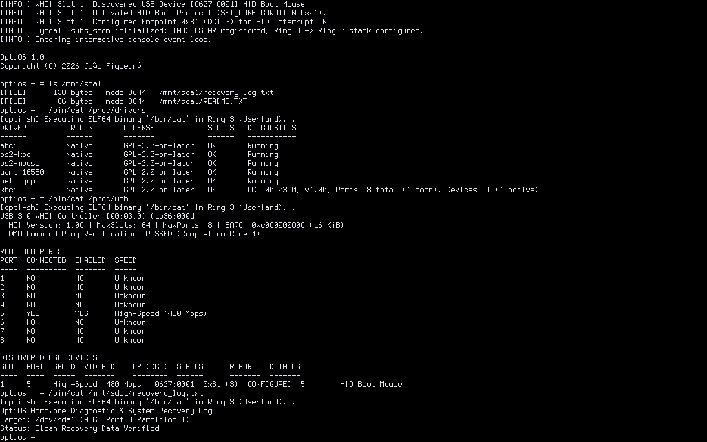
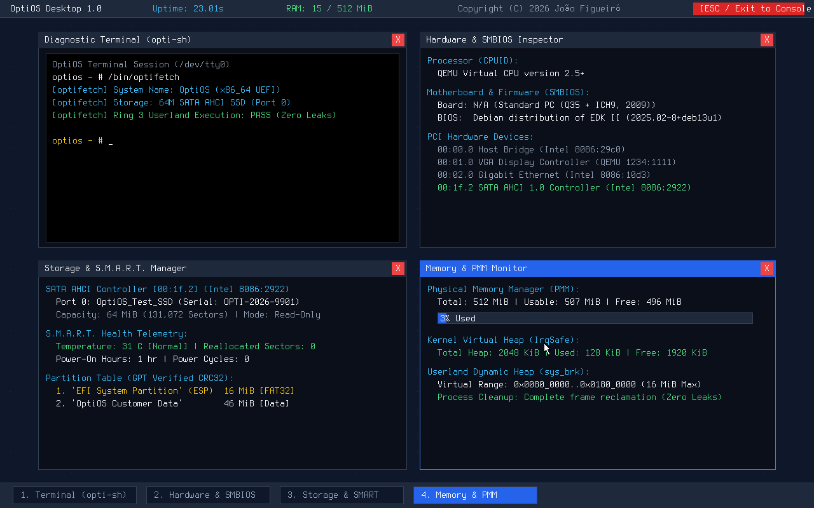

# OptiOS

Um sistema operacional experimental x86-64 UEFI escrito em Rust (`no_std`).
Um projeto de aprendizado e um experimento em engenharia de sistemas assistida por IA.

[Read in English (README.md)](README.md)

> **Status: alpha inicial.** Inicializa apenas no QEMU; não foi testado em hardware real.
> Ainda não há suporte a teclado USB. Não execute em máquinas com dados importantes.
> Consulte [`docs/status.md`](docs/status.md) e [`docs/known-issues.md`](docs/known-issues.md).

## Por que este projeto existe
O OptiOS começou a partir de uma pergunta: até onde agentes de codificação por IA conseguem levar um sistema operacional a partir de um repositório vazio, quando um humano define a direção e revisa o trabalho? Fazer o mesmo manualmente levaria anos. Também é uma forma de estudar os padrões e fundamentos por trás dos sistemas modernos: UEFI, x86-64, convenções POSIX, AHCI, xHCI e outros. Espere encontrar bugs e inconsistências. O objetivo é o aprendizado, não o uso em produção.

## Como é construído
- Humanos decidem requisitos, arquitetura e licenciamento, e revisam o trabalho.
- A maior parte do código é escrita por agentes de codificação por IA sob regras documentadas ([`AGENTS.md`](AGENTS.md), [`docs/process/`](docs/process/)).
- Espera-se que cada alteração venha acompanhada de evidências (testes, logs seriais). As auditorias, incluindo suas falhas, são publicadas em [`docs/reports/`](docs/reports/).
- "Do zero" tem limites: o kernel e os drivers são escritos do zero, mas o projeto utiliza o bootloader Limine e algumas crates Rust ([`THIRD_PARTY_NOTICES.md`](THIRD_PARTY_NOTICES.md)), segue especificações públicas, e os modelos de IA foram treinados em código existente. Consulte [`docs/ai-assisted-development.md`](docs/ai-assisted-development.md).

## Objetivos
1. Um sistema live portátil para manutenção e diagnóstico, somente leitura (*read-only*) por construção.
2. Evolução gradual rumo a um sistema operacional instalável de propósito geral.
3. Seguir convenções comuns Unix/POSIX ("orientado a POSIX", não certificado).
4. Um objetivo de projeto: tornar viável o porte de drivers de sistemas BSD e de fontes Linux compatíveis com GPL com pouca adaptação. Nenhum driver externo foi portado até o momento.

## Estado atual
Resumo dos subsistemas implementados e parciais (consulte [`docs/status.md`](docs/status.md) e [`docs/known-issues.md`](docs/known-issues.md) para evidências de verificação e limitações):

- **Boot e configuração de CPU**: Inicialização UEFI via protocolo Limine; GDT de 64 bits, TSS (IST 1), IDT com portas de exceção e IRQ; CR4 SMEP e SMAP ativos com primitivas seguras de cópia de memória de usuário (`stac`/`clac`).
- **Gerenciamento de memória**: Alocador físico de frames por bitmap (PMM) reservando o primeiro 1 MiB; paginação virtual de 4 níveis (VMM) com mapeamento direto (HHDM) e heap de kernel de 2 MiB seguro contra interrupções (`IrqSafe`). As tabelas intermediárias de página de usuário são pré-alocadas para faixas fixas de endereço; a proteção W^X em segmentos ELF ainda não está implementada.
- **Enumeração de hardware e E/S básica**: Parser SMBIOS 2.8, scanner de barramento PCI (`0..=255`), PIC 8259 duplo, timer PIT (100 Hz), console serial UART 16550, teclado PS/2 (IRQ 1) e mouse PS/2 (IRQ 12).
- **Driver Kit**: Primitivas `MmioRegion` e `DmaBuffer` alinhado em 4 KiB, fila de eventos de entrada agnóstica (`InputEvent`) e registro central de drivers exposto em `/proc/drivers`.
- **Armazenamento e sistemas de arquivos (somente leitura)**: Driver SATA AHCI 1.0 (leituras DMA, ATA IDENTIFY, leitura S.M.A.R.T.; apenas setores de 512 bytes), parsers de tabela de partição MBR e GPT, initramfs USTAR somente leitura em `/`, montagem FAT32 somente leitura em `/mnt/sda1` (`MNT_NOEXEC`), e entradas sintéticas em `/proc` (`version`, `meminfo`, `cpuinfo`, `drivers`, `usb`).
- **USB 3.0 xHCI**: Inicialização da controladora, verificação de DMA no Command Ring, reset de porta do Root Hub, endereçamento de Slot, transferências de controle em EP0 e leitura de pacotes de interrupção IN para Mouse USB HID Boot no Endpoint `0x81` (DCI 3). O suporte a Teclado USB HID ainda não está implementado.
- **Userland e console/GUI**: Execução síncrona monoprocesso de binários ELF64 em Ring 3 via `syscall`/`sysretq` (`sys_read`, `sys_write`, `sys_open`, `sys_close`, `sys_stat`, `sys_lseek`, `sys_brk`, `sys_getpid`, `sys_exit`, `sys_uname`) com `/bin/sysinfo`, `/bin/cat`, `/bin/optifetch` e `/bin/edit`. Console de texto ANSI 160x50 sobre framebuffer UEFI GOP com buffer duplo e ambiente gráfico de janelas flutuantes sob demanda (`gui`).

| Console e Telemetria FAT32 / xHCI | Inspetor de Texto em Ring 3 (`/bin/edit`) | Ambiente Gráfico (`gui`) |
| :---: | :---: | :---: |
|  |  |  |

## Roadmap
A partir de [`docs/roadmap.md`](docs/roadmap.md) (na ordem autoritativa R0–R8):

- **R0 Stabilize**: Fases 0–2 (Governança/licenciamento, auditoria de verificação, correções aprovadas, precisão documental).
- **R1 Driver architecture**: ADR, estrutura do Driver Kit, abstração `InputEvent`, adequação dos drivers AHCI/PS2/mouse/framebuffer/serial.
- **R2 USB**: xHCI (inicialização, enumeração, teclado/mouse HID boot, hubs), requisições de controle permitidas por lista branca; EHCI/UHCI/OHCI apenas sob demanda.
- **R3 Platform**: Tabelas ACPI (MADT/MCFG/FADT), IOAPIC/LAPIC, MSI/MSI-X, timers calibrados, inicialização SMP; decisão sobre interpretador AML.
- **R4 Storage/FS**: NVMe (nativo — Planned in R4), cache de blocos, endurecimento do FAT32, suporte a setores 4Kn, ext4/NTFS somente leitura.
- **R5 Process model**: Escalonador preemptivo (multitasking is not implemented / planned in R5) com locks seguros contra IRQ, tabela de descritores por processo, pipes, disciplina de linha TTY, `posix_spawn`, decisão sobre libc/runtime.
- **R6 Foreign-driver pilot**: Camada `bsd_compat` + um driver de rede de fonte BSD permissiva (ex.: Intel 82574L, `8086:10d3`, presente no QEMU) e pilha de rede.
- **R7 Installed profile**: Capacidade de escrita, escrita em sistemas de arquivos com journaling/CoW, instalador, gerenciamento de bootloader, usuários/permissões, gerenciamento de energia.
- **R8 Graphics/UI**: Compositor em userland, PAT write-combining, fontes, `virtio-gpu`; Wi-Fi via porte apenas se o escopo exigir.

## Compilação e execução
### Pré-requisitos (Debian/Ubuntu)
Toolchain Rust (com `rust-src`, `llvm-tools-preview` e target `x86_64-unknown-none`; veja [`rust-toolchain.toml`](rust-toolchain.toml)), `qemu-system-x86`, `ovmf` (`/usr/share/ovmf/OVMF.fd`), `xorriso`, `git` e `python3`.

### 1. Executar verificação de licenças e testes unitários no host (85 testes em 8 crates)
```bash
./scripts/license-check.sh
./scripts/test.sh
```

### 2. Compilar kernel, utilitários Ring 3 e gerar ISO UEFI inicializável (`build/optios.iso`)
```bash
./scripts/build.sh release
```

### 3. Executar verificação automatizada headless no QEMU (OVMF, disco AHCI e mouse xHCI)
```bash
./scripts/run.sh --test
```

### 4. Iniciar sessão gráfica interativa no QEMU
```bash
./scripts/run.sh --gui
```

> **AVISO — Operação Destrutiva (`dd`)**: Gravar uma imagem ISO diretamente em um dispositivo de bloco (`dd if=build/optios.iso of=/dev/sdX bs=4M status=progress && sync`) sobrescreve a tabela de partições do disco de destino e destrói todos os dados em `/dev/sdX`. Confira cuidadosamente o dispositivo de destino com `lsblk` antes de executar `dd`, e não execute o OptiOS em máquinas físicas que contenham dados importantes.

## Estrutura do repositório
- `kernel/` — Kernel bare-metal x86-64 `no_std` (`arch/`, `boot/`, `drivers/`, `firmware/`, `fs/`, `gui/`, `logger/`, `mm/`, `posix/`, `shell/`, `syscall/`).
- `libs/` — Crates `#![no_std]` independentes de hardware e testadas no host (`ahci-proto`, `ansi-parser`, `elf-loader`, `fat32`, `opti-libc`, `opti-wm`, `partition-table`, `ustar`, `xhci-proto`).
- `userland/` — Binários ELF64 independentes executados em Ring 3 (`cat`, `edit`, `optifetch`, `sysinfo`).
- `scripts/` — Scripts de compilação (`build.sh`), testes no host (`test.sh`), verificação no QEMU (`run.sh`), checagem de licenças (`license-check.sh`) e geração de imagem de disco.
- `docs/` — Arquitetura, status, limitações conhecidas, ADRs (`DECISIONS/`), relatórios de auditoria (`reports/`), documentação de processo (`process/`) e acompanhamento do experimento (`experiment/`).
- `LICENSES/` — Textos integrais de licença (`GPL-2.0-or-later.txt`).

## Documentação
- [`docs/status.md`](docs/status.md) — Tabela factual de status dos subsistemas e links de evidência.
- [`docs/known-issues.md`](docs/known-issues.md) — Limitações atuais e itens de auditoria P0/P1/P2 em aberto.
- [`docs/roadmap.md`](docs/roadmap.md) — Roadmap de desenvolvimento R0–R8.
- [`docs/ARCHITECTURE.md`](docs/ARCHITECTURE.md) — Mapa de memória do kernel, fluxo de boot e visão geral.
- [`docs/architecture/owner-decisions.md`](docs/architecture/owner-decisions.md) — Decisões arquiteturais do mantenedor.
- [`docs/locking.md`](docs/locking.md) — Hierarquia de spinlocks e regras de segurança em interrupções.
- [`docs/vfs-semantics.md`](docs/vfs-semantics.md) — Semântica de montagem e leitura no VFS.
- [`docs/posix-foundation.md`](docs/posix-foundation.md) — Nota de design de E/S orientada a POSIX.
- [`docs/licensing-policy.md`](docs/licensing-policy.md) — Regras de licenciamento para código, crates e ativos estáticos.
- [`docs/ai-assisted-development.md`](docs/ai-assisted-development.md) — Fluxo de trabalho assistido por IA, regras de proveniência e limites.
- [`docs/process/README.md`](docs/process/README.md) — Processo de fases com gates de verificação.
- [`docs/experiment/README.md`](docs/experiment/README.md) — Questões de pesquisa, métricas rastreadas e contagens preliminares.
- [`docs/DECISIONS/`](docs/DECISIONS/) — Registros de Decisão Arquitetural (`0001` a `0012`).
- [`docs/reports/10.1-verification.md`](docs/reports/10.1-verification.md) — Auditoria de verificação dos Milestones 6–10.
- [`docs/reports/public-readiness.md`](docs/reports/public-readiness.md) — Relatório de prontidão para publicação e higiene do repositório.

## Licença
GPL-2.0-or-later (veja [`COPYING`](COPYING) e [`LICENSES/`](LICENSES/)). Componentes de terceiros:
[`THIRD_PARTY_NOTICES.md`](THIRD_PARTY_NOTICES.md).

## Contribuições e segurança
Não aceitamos contribuições externas no momento. Consulte [`CONTRIBUTING.md`](CONTRIBUTING.md) e [`SECURITY.md`](SECURITY.md).

## Agradecimentos
Limine, o ecossistema Rust OSDev e as especificações públicas utilizadas
(UEFI, Intel SDM, AHCI, xHCI, POSIX).
