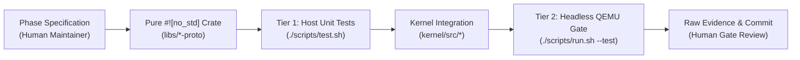

<!--
// SPDX-License-Identifier: GPL-2.0-or-later
// Copyright (C) 2026 João Figueiró
// Item: Engineering Process & Gated Phase Workflow Documentation
// Date: 2026-11-11
-->

# OptiOS — Engineering Process & Verification Workflow

OptiOS is developed through a strictly gated, evidence-driven workflow defined by the human maintainer in [`AGENTS.md`](../../AGENTS.md) and [`docs/architecture/owner-decisions.md`](../architecture/owner-decisions.md).

---

## 1. Core Working Rules

Every development phase enforces seven mandatory operational rules ([`AGENTS.md`](../../AGENTS.md) Section A):

1. **Evidence before fixes**: Never modify code or documentation to fix a behavior that has not first been demonstrated with reproducible evidence.
2. **Paste raw output**: Every phase report must include verbatim outputs from `cargo`, QEMU serial logs, `grep`, and `git diff` rather than narrative summaries.
3. **Strict scope**: Only files and subsystems explicitly authorized by the current phase may be touched, and every modified file must be listed.
4. **Integrity and safety**:
   - Host unit tests may never be weakened or edited merely to force a pass; any test modification requires an explicit technical justification.
   - Destructive git operations (`reset`, `revert`, `checkout` discarding history) are prohibited.
   - Read-only storage guarantees must remain provable at the type level (`AllowedCommand` in [`libs/ahci-proto/src/lib.rs`](../../libs/ahci-proto/src/lib.rs)); no disk-write code paths may be introduced without explicit owner authorization.
5. **Language and terminology accuracy**:
   - All source code, comments, logs, and technical docs are written in English.
   - Interfaces are described as **POSIX-oriented** (never claiming certified compliance).
   - Unimplemented features are never documented as present.
6. **Pre-phase and post-phase snapshots**: Every completed phase is recorded as an atomic Git commit (or backup tarball) before advancing.
7. **Gated phases**: Upon finishing a phase, the agent presents the raw verification output and **stops** until the human maintainer reviews and approves the next phase.

---

## 2. Two-Tier Verification Architecture

To prevent hardware-protocol bugs from hiding behind unverified kernel glue code, OptiOS splits verification into two tiers:

### Tier 1: Pure `#![no_std]` Host Protocol Crates (`libs/`)
Before touching MMIO registers or interrupt handlers in `kernel/`, binary formats and hardware protocol state machines are implemented in pure `#![no_std]` library crates:
- [`libs/ustar/`](../../libs/ustar/) — USTAR archive parsing and path traversal sanitization (24 tests).
- [`libs/ahci-proto/`](../../libs/ahci-proto/) — SATA AHCI FIS builders, PRDT layout, S.M.A.R.T. parsing, and read-only `BlockDevice` trait (11 tests).
- [`libs/partition-table/`](../../libs/partition-table/) — Protective MBR and GPT header/entry parsing with CRC32 validation (6 tests).
- [`libs/elf-loader/`](../../libs/elf-loader/) — 64-bit ELF header and `PT_LOAD` segment bounds checking (6 tests).
- [`libs/ansi-parser/`](../../libs/ansi-parser/) — ANSI/VT100 CSI escape sequence state machine (10 tests).
- [`libs/opti-wm/`](../../libs/opti-wm/) — Floating window geometry, Z-order sorting, and hit testing (5 tests).
- [`libs/fat32/`](../../libs/fat32/) — BPB validation, cluster chain traversal, and 8.3/LFN directory decoding (6 tests).
- [`libs/xhci-proto/`](../../libs/xhci-proto/) — USB 3.0 xHCI TRB builders, `PORTSC` W1C preservation, Input Context formatting, and HID Boot report decoders (17 tests).

All 85 host unit tests run natively on `x86_64-unknown-linux-gnu` alongside [`scripts/license-check.sh`](../../scripts/license-check.sh) via [`scripts/test.sh`](../../scripts/test.sh).

### Tier 2: Automated Headless QEMU / OVMF Verification (`scripts/run.sh --test`)
Compiling cleanly and passing host unit tests is necessary but not sufficient. [`scripts/run.sh`](../../scripts/run.sh) boots the generated UEFI ISO (`build/optios.iso`) inside `qemu-system-x86_64` with:
- Machine `q35` and CPU `-cpu qemu64,+smep,+smap` (enforcing hardware `CR4.SMEP` and `CR4.SMAP`).
- Tianocore EDK II UEFI firmware (`OVMF.fd`).
- A provisioned 64 MiB GPT-partitioned SATA AHCI disk (`build/test_disk.img`) containing a FAT32 partition.
- A PCIe USB 3.0 controller (`qemu-xhci`) with an attached USB HID Mouse (`usb-mouse`).

An automated Python harness connects to the QEMU monitor UNIX socket, injects keyboard commands (`ls /mnt/sda1`, `/bin/cat /proc/drivers`, `/bin/cat /proc/usb`, `/bin/cat /mnt/sda1/recovery_log.txt`, `/bin/edit /mnt/sda1/recovery_log.txt`, `gui`) and live USB mouse movements (`mouse_set 3`, `mouse_move`), captures framebuffer screendumps, and asserts against the serial log for every subsystem milestone.

---

## 3. Audit and Corrective Loop

Rather than assuming prior phases are defect-free, the process schedules explicit verification audits (such as [`docs/reports/10.1-verification.md`](../reports/10.1-verification.md)):
1. **Audit Phase (Read-Only)**: Inspect code, memory mappings, lock discipline, and documentation claims without modifying functional code. Classify every defect as `P0` (Security/Safety), `P1` (Correctness/Protocol), or `P2` (Hygiene/Docs).
2. **Remediation Phase**: Implement approved `P0` fixes first (e.g., Phase 2: `CR4.SMEP`/`SMAP`, `stac`/`clac` user copy bounds, `MNT_NOEXEC`, per-process file descriptors), backed by new unit or QEMU verification tests.
3. **Transparent Tracking**: Any remaining open `P0`/`P1`/`P2` items are published in [`docs/known-issues.md`](../known-issues.md) and [`docs/status.md`](../status.md) so the repository state is never overstated.
